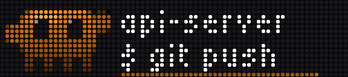
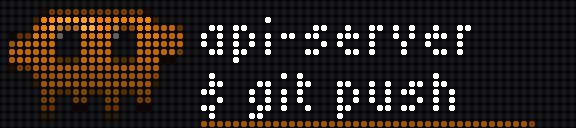
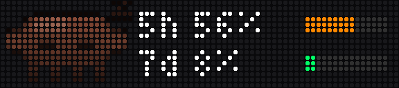

# BusyClaude

[](https://github.com/pnwclw/busyclaude/actions/workflows/ci.yml)

**Claude Code, on your BUSY Bar.** A mascot walks onto the bar when a session
needs you. Press START to allow a command, BACK to deny it, turn the wheel to
answer a question, and get back to what you were doing without reaching for the
keyboard.

<p align="center"></p>

It is a native app for the bar (it appears there as **Claude Code**) plus a hook
for Claude Code. Nothing runs in between: no server, no daemon, no account,
nothing to keep alive.

*An independent project, not made by or affiliated with Anthropic or the makers
of the BUSY Bar.*

## What it shows

| | |
|---|---|
|  | **A permission prompt** says what is about to happen: the command, the file, the address. A long one scrolls past, and one over a hundred characters is cut and says so. Line one is the project, so with several sessions open you know which one is asking. The line underneath is a fuse: when it burns out, Claude Code asks at the keyboard as usual. |
|  | **A question.** The options are listed in Claude Code; the bar shows which number the wheel is on. |
|  | **A finished turn**, a finished subagent, a session waiting for you. |
|  | **Your limits**, a few seconds into a finished turn: how much of the 5-hour and weekly allowance is used. |
|  | **A failed turn**: rate limit, overloaded, auth. |
|  | **Opened by hand** from the bar's Apps menu, it shows your limits; the wheel walks back through recent notifications. |

Each kind of event has its own colour, its own tone, and its own way of moving:

<p align="center"></p>

| Event | The bar says | Mascot |
|---|---|---|
| `PermissionRequest` | `$ npm test`, `Edit src/app.ts`, `Fetch example.com/…` | amber, marching, one arm up |
| `PermissionRequest` for `AskUserQuestion` | `option 1/4` | violet, puzzled |
| `Notification` (idle), `Elicitation`, `TeammateIdle` | `your turn`, `needs input`, `scout idle` | cyan, looking around, tapping a foot |
| `Stop` | `finished` | green, jumping |
| `SubagentStop`, `TaskCompleted` | `agent done`, `task done` | lime, two hops and a wink |
| `StopFailure` | `rate limit`, `overloaded`, … | red, shaking |

When the notification is over, **the bar goes back to what it was showing**: the
app you had open, or the bar's own screen.

## Buttons

| | A permission prompt | A question | Anything else |
|---|---|---|---|
| **START** | allow | take the option the wheel is on | dismiss |
| **BACK** | deny | leave it to the keyboard | dismiss |
| **Wheel** | switch between prompts, if several are waiting | pick an option | — |
| **Wheel button** | nothing: too easy to press by accident | take the option | dismiss |

Answering at the keyboard instead takes the notification off the bar at once.

## Install

You need a BUSY Bar on **firmware 1.3.1 or newer** (the first with apps) and
**Python 3.9+**, which a Mac with the developer tools and most Linux machines
already have. Nothing else: the app comes prebuilt.

### As a Claude Code plugin

In Claude Code:

```
/plugin install busyclaude --marketplace pnwclw/busyclaude
```

Then plug the bar in over USB and run:

```
/busyclaude:setup
```

That puts the app on the bar, then asks you to press **START** on it: a hello
alone would look the same against a bar in another room, and the button coming
back is what proves this is the bar in front of you and that its keys reach the
hook. The hooks come with the plugin and start working in your next session.
For a bar on Wi-Fi, give its address: `/busyclaude:setup --addr 192.168.1.50`.

On Claude Code older than 2.1.275, add the marketplace first:
`/plugin marketplace add pnwclw/busyclaude`, then
`/plugin install busyclaude@busyclaude`.

### From a checkout

```sh
git clone https://github.com/pnwclw/busyclaude.git
cd busyclaude
python3 busyclaude.py setup
```

`setup` installs the app on the bar, adds the hooks to
`~/.claude/settings.json` (your other hooks are left alone, and the old file is
kept beside it), and asks you to press **START** on the bar to show that the
buttons come back. `--no-confirm` skips that last step. Start a new Claude Code
session, or try a prompt right away:

```sh
python3 busyclaude.py test perm
```

**Over Wi-Fi**, give `setup` the bar's address, and its API key if you turned
protection on (bar web UI → Network → HTTP API). Both are remembered in
`~/.config/busyclaude/config.json`:

```sh
python3 busyclaude.py setup --addr 192.168.1.50 --token <API key>
```

**By hand**, if you would rather not have a script edit your settings:
`npm install && npm run build && npm run app:install` puts the app on the bar,
and [claude/settings.json](claude/settings.json) is the hooks block to merge
into your own (`python3 busyclaude.py hooks` prints it with the right paths).

### What it touches

- **Your bar**, at the one address you gave it or its USB address. Nothing else
  on the network, and nothing on the internet, with one exception below.
- **Claude Code's settings**, to add its hooks: only from a checkout, never as a
  plugin. Each hook runs [busyclaude.py](busyclaude.py), one file with no
  dependencies; from the event it takes the project folder, the kind of event
  and, for a prompt, what is about to run.
- **Your usage numbers**, if you leave that on: it reads the token the `claude`
  command keeps in the Keychain and asks the endpoint Claude Code itself uses.
  The token is never refreshed, stored or sent anywhere else.
  `BUSYCLAUDE_USAGE=0` turns this off.

To remove it: `/plugin uninstall busyclaude` or
`python3 busyclaude.py uninstall`, and `python3 busyclaude.py uninstall --app`
to take the app off the bar.

## Settings

On the bar, open **Claude Code → Setup**:

| Setting | |
|---|---|
| **Sound** | Play a tone with each notification. |
| **Blink LED** | Blink the status LED in the notification's colour. |
| **Show usage** | Follow a finished turn with your limits. Off, the text simply stays. |
| **Answer time** | How long a permission prompt waits for a button: 15, 30 or 60 seconds (the default), or 5 or 10 minutes. A question always gets at least 30 seconds. The long settings hold the session still until you answer or the fuse goes out, which is the point of them: you can walk away from the keyboard and still be the one who decides. |

## Usage numbers

The limits shown are whatever is in `~/.cache/busyclaude/usage.json`, if it is
less than a quarter of an hour old. Three things can put numbers there:

- **Claude Code's status line**, in a terminal session. Claude Code hands every
  status line command the 5-hour and weekly percentages, so
  `python3 busyclaude.py setup --statusline` adds a command that writes them
  down as they change. No credentials are involved, and a status line you
  already have keeps working: it is run after ours, with the same input.
- **By hand**: `python3 busyclaude.py usage 37 5`. This is also what an
  assistant that can see the numbers, as Claude in the desktop app can, runs
  when asked.
- **A fetch** from the endpoint Claude Code itself uses, with the token the
  `claude` command keeps in the Keychain. The token is read and never refreshed.
  It goes stale if you only use Claude Code through the desktop app, and it
  speaks for whatever `claude` last logged in to, which may be another
  subscription than the one you are spending. So it never replaces numbers
  handed over in the last quarter hour, and each hand-over asks it too: if it
  disagrees, it is left alone until a later hand-over agrees or `claude` logs
  in elsewhere. No number is shown rather than someone else's.

## How it works

```
 your computer                              the BUSY Bar
 ─────────────                              ────────────
 Claude Code
    │ runs, for each event
    ▼
 busyclaude.py hook ── writes the event ──▶ the app's localStorage
    │                                        (one JSON file on the bar)
    ├───────────── launches ──────────────▶ the app
    │                                          │ reads it, shows it:
    │                                          │ one draw, one sound
    │                                          │ START / BACK / wheel
    │ ◀──────── reads the answer ───────────── │ writes the answer
    ▼
 prints the decision; Claude Code carries on
```

An app on the bar cannot be sent anything, so the two halves share the one thing
both can reach: the app's `localStorage`, which the firmware keeps as a small
JSON file. The hook writes the event into it through the bar's storage API and
launches the app, the same call `busy-cli app run` makes. For a prompt it then
reads the file until the app has recorded a button. When the app is done, the
hook puts back what it covered: it noted that before launching, and starts that
app again, or quits ours to bring back one of the bar's own screens.

**The bar does the animating.** The mascot, the fuse and the closing wipe are
`.anim` files inside the app; a draw names a file and a section of it (`perm`,
`done`, `error`, …) and the bar plays it by itself. A notification is one draw
request and one sound request. A finished turn, start to finish, hook and app
together, is twelve requests; an earlier version of this project, which
animated from the computer, sent 238 for a single permission prompt.

**A hook never holds Claude Code up.** For everything but a prompt it hands the
event to a detached process and returns at once. With the bar unplugged it gives
up in under half a second. It always exits 0 and prints nothing, with one
exception: the decision for a prompt answered on the bar.

## Commands

```sh
python3 busyclaude.py setup            # install or update the app and the hooks
python3 busyclaude.py test [kind]      # perm, question, ask, done, agent, error, hello
python3 busyclaude.py demo             # every kind once, silently: for looking at the mascot
python3 busyclaude.py usage [5h 7d]    # show the usage numbers, or hand them over
python3 busyclaude.py status           # the bar, the app, the hooks, the last few events
python3 busyclaude.py hooks            # print the hooks block for a settings.json
python3 busyclaude.py uninstall [--app]  # remove the hooks, and with --app the app too
```

`BUSYBAR_ADDR` and `BUSYBAR_TOKEN` override the saved address and key.
`BUSYCLAUDE_APPROVE=0` shows prompts without waiting for a button;
`BUSYCLAUDE_USAGE=0` leaves the usage numbers out, and `BUSYCLAUDE_FETCH=0`
only the fetch.

## When something is off

`python3 busyclaude.py status` says what is reachable, installed and registered,
and ends with the last events a hook saw. Every hook writes one line to
`~/.cache/busyclaude/events.jsonl` with what it did and why.

- **Nothing appears.** A hook cannot say so in the terminal, so look at the log.
  `no bar at …` is the cable or the address; `written, not shown: HTTP 409` is a
  BUSY session, during which the bar turns apps away.
- **No usage numbers.** `python3 busyclaude.py usage` says what is known and
  why a fetch failed. See [Usage numbers](#usage-numbers).
- **`setup` says the bar refused the app.** Run it again: it clears what a
  failed install left behind and installs onto nothing.
- **The bar stays on the app's Start/Setup menu.** The hook that should have
  put the bar back did not get to; BACK leaves it.
- **A prompt is cut off early with hooks from an older setup.** The
  `PermissionRequest` hook needs a 90-second timeout; run `setup` again.

## Limits

These come from how the firmware works; none is hidden.

- **Every event relaunches the app.** The firmware reads `localStorage` once per
  launch, so a running app cannot notice a new event. The bar shows its
  "Loading…" for a moment each time.
- **During a BUSY session nothing is shown.** The bar refuses to launch an app
  over one, and a prompt simply appears at the keyboard.
- **What was on the bar is worked out, not asked for.** The firmware has no
  call for "what is running", so the hook reads which app the Apps menu would
  resume and checks that this app is the one drawing. An app that draws nothing,
  or one started some other way than from the Apps menu, is not recognised, and
  the bar returns to the Apps menu instead.
- **Outside the Apps position, the Apps menu forgets its app.** With the mode
  switch at BUSY or Off, the bar returns there correctly, but quitting an app
  through the API makes the Apps menu show its list the next time, instead of
  resuming the app it had.
- **The mode switch is not consulted.** A bar switched to Off is still woken by
  an event, shows it, and goes back to Off.
- **Only one question at a time is answered from the bar.** A question with
  several parts, or one that takes several answers, is shown and left to the
  keyboard.
- **The mailbox is the firmware's `localStorage` file.** Its place and format
  are the same in firmware 1.3.1 and in the current development branch, but they
  are an implementation detail. Firmware 1.4 lets an app read files under its
  own folder, which is the cleaner mailbox to move to once 1.4 is everywhere.
- **On firmware 1.3 a short BACK blanks the picture** for an instant before the
  app redraws.
- **Only the front display is used**, and one computer at a time is assumed.

## Tested on

A physical bar on firmware 1.3.1 (HTTP API 27.14.0), over Wi-Fi: notifications,
the usage screen, permission prompts and a question answered from the bar in
real Claude Code sessions, a hundred-character command scrolling through
within the answer time, and the bar returning to the app that was open before. The pictures above are that bar's display read back through its own
screen API and drawn as LEDs; in the animation, the mascot and the fuse are the
frames of the app's own animation files laid over such a capture.

Checked only on the stand-in bar that `npm test` runs against: two prompts at
once, a prompt left to burn out, the "Answer time" and "Show usage" settings,
the status line, and a bar connected over USB.

## Working on it

```sh
npm install
npm run typecheck
npm test               # builds, then runs the hook against the built app on a stand-in bar
npm run assets         # regenerate the .anim, .snd and icon files from tools/assets.py
npm run package        # rebuild release/, the app the plugin and `setup` install
node tools/fakebar.mjs # the stand-in bar on 127.0.0.1:8080, to poke at by hand
python3 tools/shots.py --capture   # retake this README's pictures from a real bar
```

```
src/                 the app that runs on the bar (TypeScript)
  main.ts            what to show and when; input; the one timer
  mailbox.ts         the localStorage keys shared with the hook
  screens.ts         the 72×16 layouts
  kinds.ts           a colour, a motion and a tone per kind of event
  animations/        clawd.anim (the mascot), the fuses, wipe.anim   ← generated
  sounds/            one .snd per tone                               ← generated
  appmeta/           manifest, the Setup screen, icons
shared/device.ts     the bar's HTTP API, as the app uses it
busyclaude.py        the hook, and setup / test / status
.claude-plugin/      this repository as a Claude Code plugin, and as the marketplace that lists it
hooks/hooks.json     the plugin's hooks
skills/setup/        the plugin's /busyclaude:setup
release/             the built app, as the plugin and `setup` install it
claude/settings.json the hooks, for merging by hand
tools/assets.py      generates every binary asset; the .anim encoder is a port of the firmware's
tools/fakebar.mjs    the stand-in bar: its HTTP API and its JavaScript runtime
tools/shots.py       this README's pictures
test/                the hook against the app, and the tables both sides share
docs/                the pictures, and the captures they are drawn from
```

Pushing a git tag equal to the manifest's `version` (say `0.1.0`) builds the app
and attaches `app.pnwclw.busyclaude-<version>.tgz` to a GitHub release;
`setup --package <file>` installs one of those instead of the copy in
`release/`.

[AGENTS.md](AGENTS.md) has the rules for changing any of it.

## License

[MIT](LICENSE)
